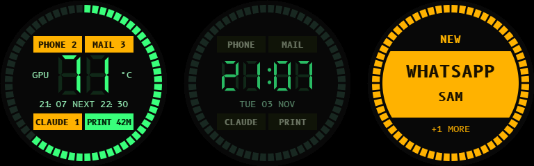

# HOUSTON: Tiny Mission Control for Your Monitor

*Houston, we have a notification.*

A 1.28-inch round screen and an ESP32-C6 that sit on your monitor and answer one question at a glance while you game: do I need to pause?



| On the face | Shows | Comes from |
| --- | --- | --- |
| PHONE and MAIL lamps; call and message panels | Counts, app and sender (never message text) | iPhone over Bluetooth |
| PRINT lamp and ring | Time left and progress | Bambu printer on your network, through the PC helper |
| CLAUDE lamp and panel | Claude Code sessions that need you | Claude Code hooks, through the PC helper |
| Big digits | GPU temperature while gaming, otherwise the clock | `nvidia-smi` through the PC helper; internet time |
| Line under the digits | Time or date, next calendar event | Internet time; calendar through the PC helper |

A source that goes quiet shows `--`, never old numbers.

## What you need

- **Board:** [ESP32-C6 Super Mini](https://www.amazon.es/dp/B0FKH2M99L?tag=tinymission-21) with 4 MB flash and USB-C, about 26 x 18 mm (28 mm long with the USB port)
- **Screen:** [1.28-inch round IPS module](https://www.amazon.es/dp/B0CFXY1K1T?tag=tinymission-21) with a GC9A01A driver, 240x240, SPI, and 8 pins: GND, VCC, SCL, SDA, RES, DC, CS, BLK. Modules without a BLK pin won't match this wiring.
- **Wires:** 8 thin wires, about 1.3 mm thick with insulation or less
- **Tools:** a soldering iron and solder
- **Power:** a USB-C cable
- **Case:** PLA filament, about 21 g without a mount (slicer estimate), printed at 0.12 mm layers with 4 walls and no supports
- An iPhone for the notifications
- A Windows PC with Python 3.11 or newer for the PC helper, and an Nvidia GPU for the temperature

Links to the exact modules I used. As an Amazon Associate I earn from qualifying purchases. (En calidad de Afiliado de Amazon, obtengo ingresos por las compras adscritas que cumplen los requisitos aplicables.)

The printer, Claude Code and calendar are all optional: leave one out and its lamp shows `--`.

The printed case and mount are a separate download. A link will follow here.

## Wiring

```text
SCREEN (GC9A01A)        ESP32-C6 SUPER MINI
                        Edge A, counted from the USB end
GND  -----------------  GND   2nd pad
VCC  -----------------  3V3   3rd pad
SCL  -----------------  19    5th pad
SDA  -----------------  18    6th pad

                        Edge B, counted from the USB end
RES  -----------------  7     10th pad
DC   -----------------  6     9th pad
CS   -----------------  3     6th pad
BLK  -----------------  2     5th pad
```

Wired this way, none of the wires cross. Go by the labels printed on your board, as the pad positions are only a guide. Keep the wires short, so the case can close flush.

## Firmware

Download this repository with **Code > Download ZIP** and extract it, or clone it with Git. Open a terminal in the extracted repository folder (the one containing this README). Run the commands below from that folder.

Copy `firmware/Houston/secrets.example.h` to `secrets.h` next to it, and fill in your Wi-Fi details and time zone.

- Git ignores `secrets.h`, so your details stay out of the repo.
- The board only joins 2.4 GHz networks.
- There's no setup screen: the details are compiled into the firmware, so a new network or password means flashing again.
- They're stored unencrypted on the board, so anyone holding it could read them out.

Install [arduino-cli](https://docs.arduino.cc/arduino-cli/installation/) and the ESP32 core. This project uses the 3.x core APIs; the development environment uses 3.3.11:

```bash
arduino-cli core update-index --additional-urls https://espressif.github.io/arduino-esp32/package_esp32_index.json
arduino-cli core install esp32:esp32@3.3.11 --additional-urls https://espressif.github.io/arduino-esp32/package_esp32_index.json
arduino-cli lib update-index
```

Install the libraries:

```bash
arduino-cli lib install "Adafruit GFX Library@1.13.0" "Adafruit GC9A01A@1.1.1" "Adafruit BusIO@1.17.4" "ArduinoJson@7.4.3" "NimBLE-Arduino@2.5.2"
```

```bash
arduino-cli compile --fqbn esp32:esp32:esp32c6:FlashSize=4M,PartitionScheme=huge_app,CDCOnBoot=cdc firmware/Houston
```

Connect the board with a USB data cable. Run `arduino-cli board list` to find its port, then replace `YOUR_PORT` below (for example, `COM5` on Windows).

```bash
arduino-cli upload --fqbn esp32:esp32:esp32c6:FlashSize=4M,PartitionScheme=huge_app,CDCOnBoot=cdc --port YOUR_PORT firmware/Houston
```

In the Arduino IDE the same settings are: ESP32C6 Dev Module, 4 MB flash, Huge APP partition scheme, USB CDC On Boot enabled.

## Pairing the iPhone

iOS doesn't list Houston in Settings > Bluetooth. To pair, connect once from a scanner app such as nRF Connect: Houston asks for pairing as soon as it's connected, so the iPhone shows the prompt. There's no passkey to enter, because the board has no buttons: just accept it. Afterwards it's under My Devices in Settings and reconnects by itself. Notification sharing is the toggle behind its (i) button.

Don't pair it with a PC: that connection stops the advertising the iPhone needs.

iOS resends its whole Notification Centre on every connection, marked as old. Houston skips those, so the counts cover what arrived while connected.

Over USB serial, `STATUS` logs memory and the link stage, and `FORGET` clears the pairing (forget Houston on the iPhone too).

## PC helper

`pc_helper/houston_helper.py` sends the display a short message over Wi-Fi every 2 seconds and on any change. The display goes back to `--` after 15 seconds without one.

```bash
python -m pip install -r pc_helper/requirements.txt
```

To try it from the repo, copy `pc_helper/config.example.json` to `pc_helper/houston.local.json` and fill it in. It stays on your PC and git ignores it.

```bash
python pc_helper/houston_helper.py --once
```

That gathers once and prints the message without sending it. To run it for good, this copies the helper to `HoustonHelper` in your user folder and starts it at every login through the scheduled task "Houston helper". The settings file there is `houston.local.json`.

```powershell
.\tools\install_helper.ps1
```

The installer creates a separate settings file; it does not copy the configuration you tested in the repository. After installation, copy your tested configuration and restart the helper:

```powershell
Stop-ScheduledTask -TaskName 'Houston helper'
Copy-Item .\pc_helper\houston.local.json "$HOME\HoustonHelper\houston.local.json"
Start-ScheduledTask -TaskName 'Houston helper'
```

Logs go to `houston_helper.log` in your temp folder.

### Settings

- **`timezone`:** an IANA name such as `America/New_York`. Empty uses your PC's current offset.
- **`printer`:** the IP address, serial number and LAN access code from the printer's network settings. If it connects but shows no data, check Developer Mode on the printer.
- **`calendar_url`:** the secret iCal link of your calendar. In Google Calendar it's under Settings > the calendar > Integrate calendar > Secret address in iCal format. Treat it like a password.

### Claude Code

Merge `pc_helper/claude_hooks.example.json` into `~/.claude/settings.json`. The hooks post to the helper on your own PC, with a 2-second timeout, and a stopped helper doesn't block Claude Code.

### Game detection

GPU load of 50% or more for 20 seconds, ended by under 20% for 60 seconds. A render counts too.

## Privacy

- **Sent to the display:** numbers, the print's file name, a session's title and the next event's name and time. They travel as plain text over UDP on your home network, with no password, so use a network you trust.
- **Dropped on arrival:** prompts and tool input, which reach the helper with Claude Code's hooks.
- **iPhone:** only the app and the sender are requested, never the message. The serial log gives the sender's length, not the name.
- **Printer:** the helper connects over TLS on your network. The certificate isn't verified because printers use a self-signed one. It asks once for the full status when it connects and sends nothing else, so it can't start, stop or change a print.

## Status

Built and used on one board, with an iPhone and an Nvidia GPU on Windows 11.

The public Houston firmware has been tested successfully on the board by the builder (4 November 2026). The revised printed back cover has also been printed and confirmed to close flush.

Not confirmed yet:

- Notifications while the iPhone is on Focus
- The MAIL lamp with a real email
- The printer link on a real printer
- The install script, and the helper starting at a real login
- A long gaming session

## Licence

[PolyForm Noncommercial 1.0.0](LICENSE): free for personal and other non-commercial use, but you can't sell it.

The B612 Mono glyphs in `firmware/Houston/AAFonts.h` are under the SIL Open Font License 1.1 ([licenses/OFL-B612.txt](licenses/OFL-B612.txt)).

Installed separately, under their own licences: Adafruit GFX and Adafruit GC9A01A (BSD), Adafruit BusIO and ArduinoJson (MIT), NimBLE-Arduino (Apache 2.0), paho-mqtt (EPL 2.0 or EDL 1.0), tzdata (Apache 2.0).

Not affiliated with Apple, Bambu Lab, Nvidia or Anthropic.
